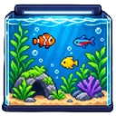
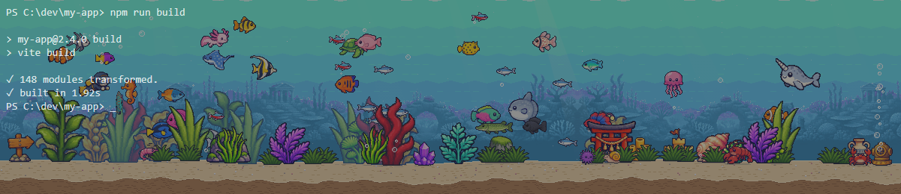
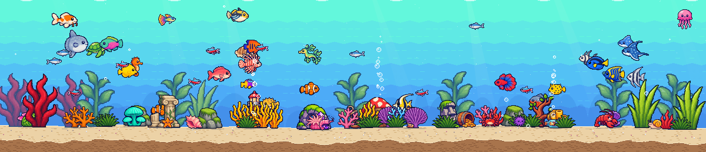
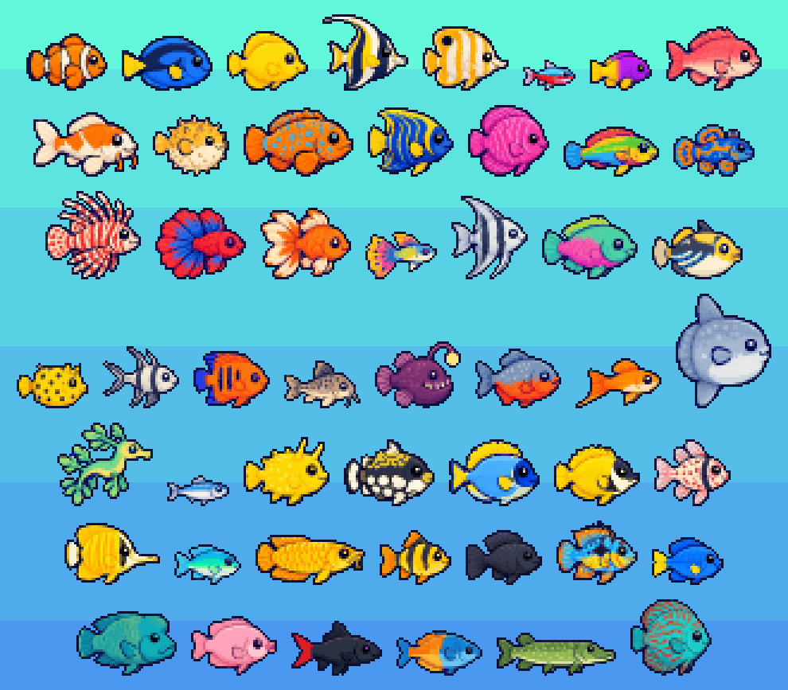
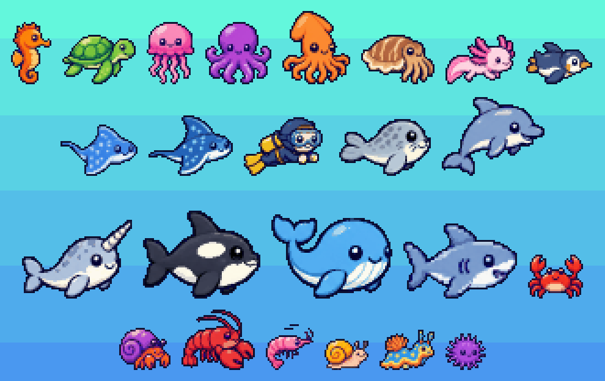
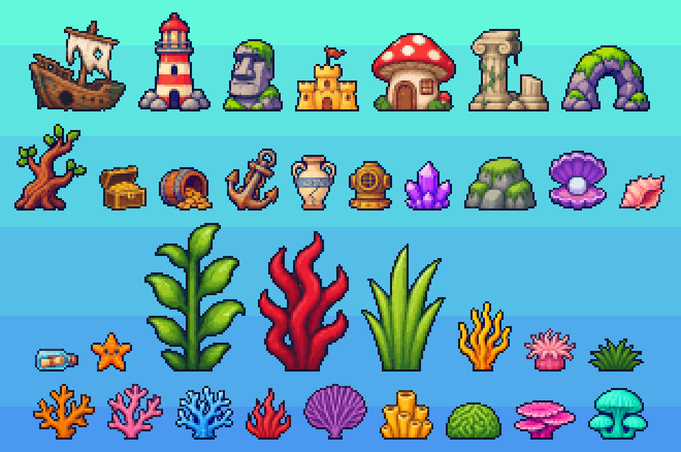

<div align="center">



# Terminal Pixel Aquarium

**Un aquarium vivant en pixel art derrière votre terminal VS Code.**

Les poissons nagent derrière vos commandes, mangent quand vous appuyez sur <kbd>Entrée</kbd> et filent quand la souris approche.

[](https://github.com/EnzoSCH1/vscode-terminal-aquarium)
[](https://code.visualstudio.com/)
[](LICENSE)
[](https://marketplace.visualstudio.com/items?itemName=EnzoSCH1.vscode-terminal-aquarium)

[English](README.md) · **Français**


</div>

---

## Pourquoi vous allez l'aimer

| | |
|---|---|
| 🐠 **32 espèces de poissons** | Poisson-clown, chirurgien bleu, combattant, poisson rouge, koï, poisson-lion, baudroie, poisson-lune… chacun avec sa queue animée. Néons et sardines nagent en banc, les clowns restent près de leur anémone. |
| 🐙 **22 autres animaux** | Hippocampe, tortue, méduse, pieuvre, axolotl, manchot, dauphin, narval, bébé baleine, un plongeur qui fait des bulles, crabes, homard, limace de mer… et un bébé requin qui fait fuir tout le monde. |
| 🌿 **35 décors** | Kelp et algues qui ondulent, 10 coraux, épave, phare, statue moaï, château de sable, maison champignon, ruines, coffre au trésor, ancre, amphore, cristaux… |
| 🍤 **Il réagit à ce que vous faites** | Appuyez sur <kbd>Entrée</kbd> dans le terminal : de la nourriture tombe. Les poissons se précipitent, les animaux du fond ramassent ce qui atteint le sable, et tout le monde s'écarte quand le curseur approche. |
| 🎲 **Jamais le même aquarium** | Chaque nouveau décor tire un mélange différent de grands décors, de coraux, de poissons et d'animaux. Ou composez le vôtre, clic après clic. |
| ⌨️ **Il ne gêne pas** | L'aquarium est une couche transparente : le texte du terminal reste net et entièrement utilisable. Un clic suffit pour le masquer. |

## Captures d'écran

**Derrière le terminal** — le rendu par défaut. Le texte reste lisible.



**Couleurs pleines** — changez de rendu quand vous voulez que l'aquarium ressorte.



**Menu compact** — tout est derrière le petit bouton 🐠 dans le coin.


## Les habitants

<details open>
<summary><b>Poissons</b> (32)</summary>



</details>

<details>
<summary><b>Animaux</b> (22)</summary>



</details>

<details>
<summary><b>Plantes, coraux et décors</b> (35)</summary>



</details>

## Installation

1. Installez **Terminal Pixel Aquarium** depuis le [Marketplace de VS Code](https://marketplace.visualstudio.com/items?itemName=EnzoSCH1.vscode-terminal-aquarium), ou depuis un fichier `.vsix` avec **Extensions : Installer à partir de VSIX…**
2. Acceptez la proposition d'activation, ou ouvrez la palette de commandes (<kbd>Ctrl</kbd>+<kbd>Maj</kbd>+<kbd>P</kbd> / <kbd>Cmd</kbd>+<kbd>Maj</kbd>+<kbd>P</kbd>) et lancez **Terminal Aquarium: Enable / Update Background**.
3. Rechargez la fenêtre quand l'extension le demande. Si VS Code est installé pour tous les utilisateurs, il faudra peut-être le lancer en administrateur pour cette étape.

Relancez la même commande après chaque mise à jour de l'extension, et après chaque mise à jour de VS Code (les mises à jour restaurent les fichiers d'origine).

## Utilisation

Ouvrez le panneau du bas et cliquez sur le bouton **🐠** dans son coin inférieur droit.

| Commande | Effet |
|---|---|
| ⌨️ | Mode normal. Les clics vont au terminal comme d'habitude. |
| ➕ + liste | Choisissez un poisson, un animal, une plante, un corail ou un décor dans la liste, puis cliquez dans l'aquarium pour le placer. |
| 🧽 | Cliquez sur un élément pour le retirer. |
| 🍤 | Cliquez n'importe où pour y lâcher de la nourriture. |
| Sol | Sable, pierre grise, volcanique ou mousse verte. |
| Rendu | *Lumineux* garde le texte du terminal net (par défaut). *Couleurs pleines* affiche l'aquarium en pleine couleur. |
| Taille | `x0.5` petit, `x1` normal, `x2` gros pixels. |
| Curseur | Opacité de l'aquarium. |
| Entrée / Souris / Rayons | Active ou non la nourriture sur <kbd>Entrée</kbd>, la fuite devant la souris et les rayons de soleil. |
| 🍤 Nourrir | Nourrit tout l'aquarium. |
| 🎲 Nouveau décor | Génère un nouvel aquarium au hasard. |
| 🧹 / ⏸ | Vide l'aquarium / masque ou affiche l'aquarium. |

Appuyez sur <kbd>Échap</kbd> pour quitter l'outil placer, retirer ou nourrir. Le décor et les réglages sont enregistrés localement et retrouvés à la prochaine ouverture de VS Code.

### Commandes

| Commande | Description |
|---|---|
| `Terminal Aquarium: Enable / Update Background` | Installe ou met à jour l'aquarium dans VS Code. |
| `Terminal Aquarium: Disable Background` | Retire l'aquarium et recharge la fenêtre. |

## À savoir

> [!WARNING]
> VS Code n'offre aucune API officielle pour dessiner derrière le terminal. Pour afficher l'aquarium, cette extension **modifie un fichier du dossier d'installation de VS Code** (le HTML du Workbench) et retire sa balise Content Security Policy.

- VS Code peut afficher un avis **« installation corrompue »** ou **[Non pris en charge]**. C'est la conséquence attendue de cette modification.
- Retirer la CSP **affaiblit une protection de sécurité du Workbench** tant que l'aquarium est activé. N'utilisez l'extension que si vous comprenez et acceptez cela.
- **Disable Background** retire le script de l'aquarium mais ne remet pas la balise CSP. Pour retrouver VS Code exactement comme à l'origine, désactivez l'aquarium puis mettez à jour ou réinstallez VS Code.
- Une mise à jour de VS Code écrase la modification. Il suffit de relancer la commande d'activation.

## Questions fréquentes

**Mon terminal reste-t-il utilisable ?**
Oui. En mode normal, l'aquarium ignore complètement la souris et le clavier.

**Le texte est difficile à lire avec mon thème.**
Baissez l'opacité avec le curseur. Le rendu par défaut est pensé pour les thèmes sombres ; avec un thème clair, essayez les couleurs pleines avec une opacité faible.

**L'aquarium a disparu après une mise à jour.**
Relancez **Terminal Aquarium: Enable / Update Background**.

**Peut-on le mettre en pause ?**
Oui, le bouton ⏸ masque l'aquarium et arrête son dessin.

## Pour contribuer

Tout le moteur de rendu est dans [`aquarium-inject.js`](aquarium-inject.js). Les sprites y sont embarqués sous forme d'un atlas unique (le bloc `ATLAS`).

```bash
# Reconstruire l'atlas à partir des planches du dossier art/ (Python, Pillow et NumPy requis)
python tools/build_atlas.py

# Reconstruire les images de galerie de ce README
python tools/build_gallery.py
```

Pour ajouter une planche de sprites : déposez-la dans `art/`, déclarez les noms et les tailles de ses sprites dans `tools/build_atlas.py`, puis ajoutez les nouvelles entrées au catalogue en haut de `aquarium-inject.js`.

## Licence

[MIT](LICENSE)
