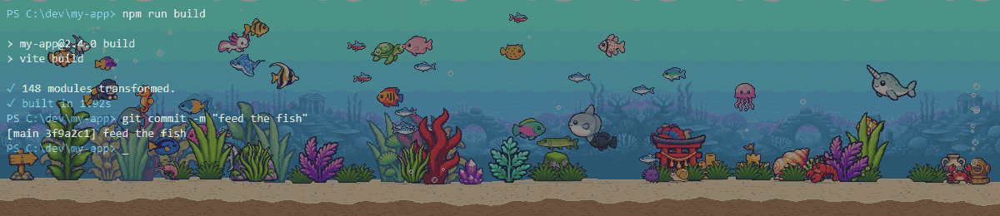
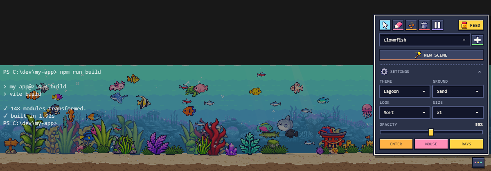
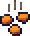
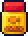

<div align="center">


# Terminal Pixel Aquarium

**Un aquarium vivant en pixel art derrière votre terminal VS Code.**

Les poissons nagent derrière vos commandes, mangent quand vous appuyez sur <kbd>Entrée</kbd> et filent quand la souris approche.

[](https://github.com/EnzoSCH1/vscode-terminal-aquarium)
[](https://code.visualstudio.com/)
[](LICENSE)
[](https://marketplace.visualstudio.com/items?itemName=EnzoSCH1.vscode-terminal-aquarium)

[Signaler un bug](https://github.com/EnzoSCH1/vscode-terminal-aquarium/issues/new?title=Bug%20report) · [Proposer une fonctionnalité](https://github.com/EnzoSCH1/vscode-terminal-aquarium/issues/new?title=Feature%20request)

[English](README.md) · **Français**



</div>

---

## Sommaire

- [Pourquoi vous allez l'aimer](#pourquoi-vous-allez-laimer)
- [Captures d'écran](#captures-décran)
- [Les habitants](#les-habitants)
- [Installation](#installation)
- [Utilisation](#utilisation)
- [À savoir](#à-savoir)
- [Questions fréquentes](#questions-fréquentes)
- [Pour contribuer](#pour-contribuer)
- [Licence](#licence)

## Pourquoi vous allez l'aimer

| | |
|---|---|
| 🐠 **50 espèces de poissons** | Poisson-clown, chirurgien bleu, combattant, poisson rouge, koï, poisson-lion, baudroie, poisson-lune… chacun avec sa queue animée. Néons et sardines nagent en banc, les clowns restent près de leur anémone. |
| 🐙 **24 autres animaux** | Hippocampe, tortue, méduse, pieuvre, axolotl, manchot, dauphin, narval, bébé baleine, bébé orque, bébé phoque, calamar, seiche, raie manta, oursin, bernard-l'ermite, plongeur… et un bébé requin qui fait fuir tout le monde. |
| 🌿 **67 décors** | 13 plantes qui ondulent, 18 coraux, épave, phare, statue moaï, portail torii, volcan, sous-marin jaune, tour en ruine, château de sable, maison champignon, coffre au trésor, canon, soucoupe volante, pont de pierre, totem tiki, maison coquillage, barre de navire, lanterne, rocher crâne et plus encore. |
| 🍤 **Il réagit à ce que vous faites** | Appuyez sur <kbd>Entrée</kbd> dans le terminal : de la nourriture tombe. Les poissons se précipitent, les animaux du fond ramassent ce qui atteint le sable, et tout le monde s'écarte quand le curseur approche. |
| 🎲 **Jamais le même aquarium** | Chaque nouveau décor tire un mélange différent de grands décors, de coraux, de poissons et d'animaux. Ou composez le vôtre, clic après clic. |
| ⌨️ **Il ne gêne pas** | L'aquarium est une couche transparente : le texte du terminal reste net et entièrement utilisable. Un clic suffit pour le masquer. |

## Captures d'écran

**Derrière le terminal** — le rendu par défaut. Le texte reste lisible.


**Couleurs pleines** — changez de rendu quand vous voulez que l'aquarium ressorte.


**Menu compact** — tout est derrière le petit bouton **⋯** dans le coin.



## Les habitants

<details open>
<summary><b>Poissons</b> (50)</summary>


</details>

<details>
<summary><b>Animaux</b> (24)</summary>


</details>

<details>
<summary><b>Plantes, coraux et décors</b> (67)</summary>


</details>

## Installation

1. Installez **Terminal Pixel Aquarium** depuis le [Marketplace de VS Code](https://marketplace.visualstudio.com/items?itemName=EnzoSCH1.vscode-terminal-aquarium), ou depuis un fichier `.vsix` avec **Extensions : Installer à partir de VSIX…**
2. Acceptez la proposition d'activation, ou ouvrez la palette de commandes (<kbd>Ctrl</kbd>+<kbd>Maj</kbd>+<kbd>P</kbd> / <kbd>Cmd</kbd>+<kbd>Maj</kbd>+<kbd>P</kbd>) et lancez **Terminal Aquarium: Enable / Update Background**.
3. Rechargez la fenêtre quand l'extension le demande. Si VS Code est installé pour tous les utilisateurs, il faudra peut-être le lancer en administrateur pour cette étape.

Ensuite, il n'y a rien à retenir : quand l'extension ou VS Code est mis à jour, l'aquarium est rafraîchi automatiquement au démarrage suivant et un bouton **Reload window** vous est proposé.

## Utilisation

Ouvrez le panneau du bas et cliquez sur le petit bouton **⋯** dans son coin inférieur droit. Un clic en dehors du menu le referme.

Le menu est en anglais ; les intitulés ci-dessous sont ceux affichés à l'écran.

### Commandes principales

| | Commande | Effet |
|:---:|---|---|
|  | **Normal mode** | Les clics vont au terminal comme d'habitude. |
|  | **Remove** | Cliquez sur un élément de l'aquarium pour le retirer. |
|  | **Drop food** | Cliquez n'importe où dans l'aquarium pour y lâcher de la nourriture. |
|  | **Clear all** | Vide l'aquarium. |
|  | **Hide / show** | Masque l'aquarium, ou le réaffiche. |
|  | **Feed** | Nourrit tout l'aquarium d'un coup. |
|  | **Item to place** | Choisissez un poisson, un animal, une plante, un corail ou un décor dans la liste, puis cliquez dans l'aquarium pour le placer. |
|  | **New scene** | Génère un nouvel aquarium au hasard. |
|  | **Settings** | Affiche ou masque les réglages ci-dessous. |

### Réglages

| Réglage | Effet |
|---|---|
| **Theme** | Six ambiances : Lagoon (récif turquoise), Sunset (eau orangée, ruines antiques), Night (bleu profond, château à l’horizon), Emerald (eau verte, statues moussues), Pink dream (châteaux de sable et coquillages pastel) et Red temple (eau pourpre, torii, pagode et lune). |
| **Ground** | Sable, pierre grise, volcanique ou mousse verte. |
| **Look** | *Soft* garde le texte du terminal net (par défaut). *Full color* affiche l'aquarium en pleine couleur. |
| **Size** | `x0.5` petit, `x1` normal, `x2` gros pixels. |
| **Opacity** | Règle la visibilité de l'aquarium. |
| **Enter / Mouse / Rays** | Active ou non : la nourriture sur <kbd>Entrée</kbd>, la fuite des poissons devant la souris, et les rayons de lumière. |

Appuyez sur <kbd>Échap</kbd> pour quitter l'outil placer, retirer ou nourrir. Le décor et les réglages sont enregistrés localement et retrouvés à la prochaine ouverture de VS Code.

### Commandes

| Commande | Description |
|---|---|
| `Terminal Aquarium: Enable / Update Background` | Installe ou met à jour l'aquarium dans VS Code. |
| `Terminal Aquarium: Disable Background` | Retire l'aquarium et recharge la fenêtre. |

## À savoir

> [!WARNING]
> VS Code n'offre aucune API officielle pour dessiner derrière le terminal. Pour afficher l'aquarium, cette extension **modifie un fichier du dossier d'installation de VS Code** (le HTML du Workbench) et retire sa balise Content Security Policy.

- VS Code peut afficher un avis **« installation corrompue »** ou **[Non pris en charge]**. C'est la conséquence attendue de cette modification.
- Retirer la CSP **affaiblit une protection de sécurité du Workbench** tant que l'aquarium est activé. N'utilisez l'extension que si vous comprenez et acceptez cela.
- L'extension garde une copie du fichier d'origine avant de le modifier. **Disable Background** remet cette copie en place : VS Code revient exactement à son état initial, balise CSP comprise.
- Une mise à jour de VS Code écrase la modification. L'extension le remarque au démarrage suivant, remet l'aquarium toute seule et propose de recharger la fenêtre.

## Questions fréquentes

**Mon terminal reste-t-il utilisable ?**
Oui. En **Normal mode**, l'aquarium ne capture ni les clics ni la saisie au clavier. Les poissons peuvent tout de même réagir à la souris et la touche <kbd>Entrée</kbd> les nourrit par défaut ; ces deux comportements peuvent être désactivés dans les réglages.

**Le texte est difficile à lire avec mon thème.**
Baissez l'opacité avec le curseur. Le rendu par défaut est pensé pour les thèmes sombres ; avec un thème clair, essayez les couleurs pleines avec une opacité faible.

**L'aquarium a disparu après une mise à jour.**
Redémarrez VS Code : l'extension le remet toute seule et propose de recharger la fenêtre. Si rien ne se passe, lancez **Terminal Aquarium: Enable / Update Background**.

**Peut-on le mettre en pause ?**
Oui, le bouton ⏸ masque l'aquarium et arrête son dessin.

## Pour contribuer

Tout le moteur de rendu est dans [`aquarium-inject.js`](aquarium-inject.js). Les sprites y sont embarqués sous forme d'un atlas unique (le bloc `ATLAS`).

```bash
# Reconstruire l'atlas à partir des planches du dossier art/ (Python, Pillow et NumPy requis)
python tools/build_atlas.py

# Reconstruire les images de galerie de ce README
python tools/build_gallery.py
```

Pour ajouter une planche de sprites : déposez-la dans `art/`, déclarez les noms et les tailles de ses sprites dans `tools/build_atlas.py`, puis ajoutez les nouvelles entrées au catalogue en haut de `aquarium-inject.js`.

## Licence

[MIT](LICENSE)
