<div align="center">

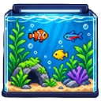

# Terminal Pixel Aquarium

**A living pixel-art aquarium behind your VS Code terminal.**

Fish swim behind your commands, eat when you press <kbd>Enter</kbd>, and dart away from your mouse.

[](https://github.com/EnzoSCH1/vscode-terminal-aquarium)
[](https://code.visualstudio.com/)
[](LICENSE)
[](https://marketplace.visualstudio.com/items?itemName=EnzoSCH1.vscode-terminal-aquarium)

[Report a Bug](https://github.com/EnzoSCH1/vscode-terminal-aquarium/issues/new?title=Bug%20report) · [Request a feature](https://github.com/EnzoSCH1/vscode-terminal-aquarium/issues/new?title=Feature%20request)

**English** · [Français](README.fr.md)

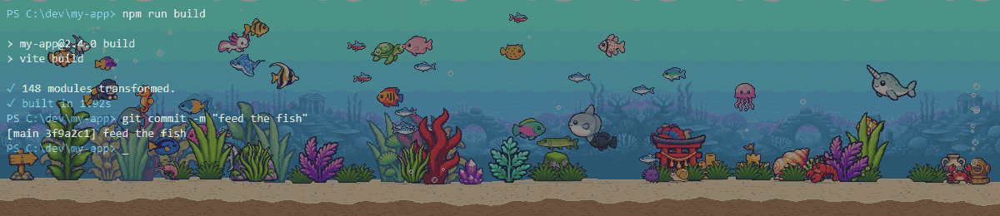

</div>

---

## Table of Contents

- [Why you'll like it](#why-youll-like-it)
- [Screenshots](#screenshots)
- [Meet the residents](#meet-the-residents)
- [Installation](#installation)
- [Usage](#usage)
- [Good to know](#good-to-know)
- [FAQ](#faq)
- [For contributors](#for-contributors)
- [License](#license)

## Why you'll like it

| | |
|---|---|
| 🐠 **50 fish species** | Clownfish, blue tang, betta, goldfish, koi, lionfish, anglerfish, sunfish… each with an animated tail. Neon tetras and sardines swim in schools, clownfish stay close to their anemone. |
| 🐙 **24 other animals** | Seahorse, turtle, jellyfish, octopus, axolotl, penguin, dolphin, narwhal, baby whale, baby orca, baby seal, squid, cuttlefish, manta ray, sea urchin, hermit crab, a scuba diver blowing bubbles… and a baby shark that scares everyone else. |
| 🌿 **67 decorations** | 13 swaying plants, 18 corals, shipwreck, lighthouse, moai statue, torii gate, volcano, yellow submarine, ruined tower, sandcastle, mushroom house, treasure chest, cannon, flying saucer, stone bridge, tiki totem, shell house, ship's wheel, lantern, skull rock and more. |
| 🍤 **It reacts to you** | Press <kbd>Enter</kbd> in the terminal and food drops in. Fish race for it, bottom-dwellers pick up what reaches the sand, and everyone scatters when your cursor gets close. |
| 🎲 **Never the same tank** | Every new scene draws a different mix of landmarks, corals, fish and animals. Or build your own, one click at a time. |
| ⌨️ **Stays out of your way** | The aquarium is a see-through layer: your terminal text stays crisp and fully usable. Hide it in one click. |

## Screenshots

**Behind your terminal** — the default look. Text stays readable.

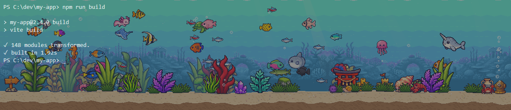

**Full colors** — switch the render mode when you want the tank to pop.

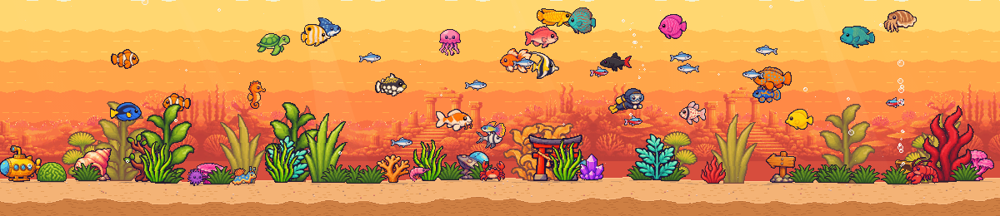

**Compact menu** — everything is behind the small **⋯** button in the corner.

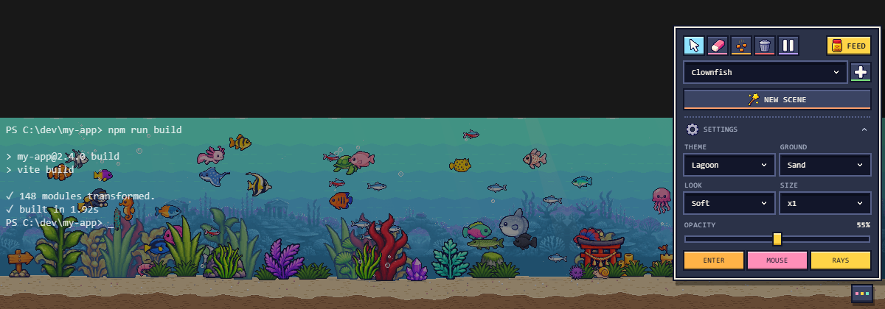

## Meet the residents

<details open>
<summary><b>Fish</b> (50)</summary>

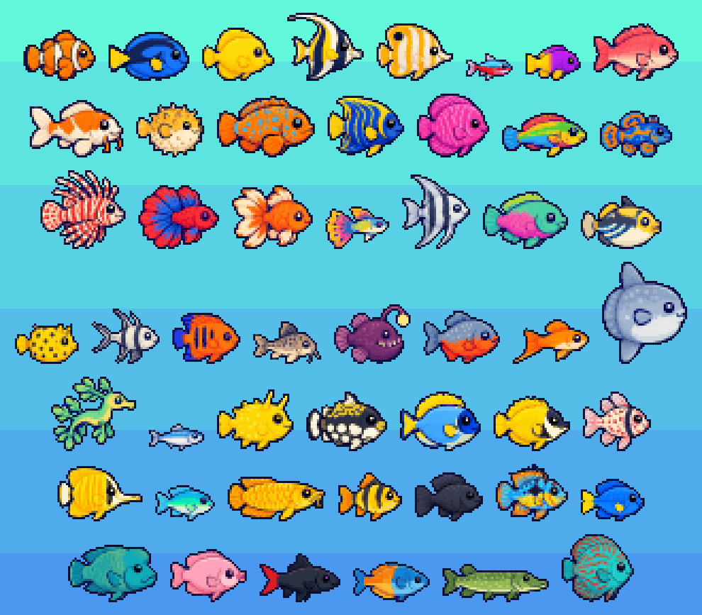

</details>

<details>
<summary><b>Animals</b> (24)</summary>


</details>

<details>
<summary><b>Plants, corals and decorations</b> (67)</summary>


</details>

## Installation

1. Install **Terminal Pixel Aquarium** from the [VS Code Marketplace](https://marketplace.visualstudio.com/items?itemName=EnzoSCH1.vscode-terminal-aquarium), or from a `.vsix` file with **Extensions: Install from VSIX…**
2. Accept the prompt to enable the aquarium, or open the Command Palette (<kbd>Ctrl</kbd>+<kbd>Shift</kbd>+<kbd>P</kbd> / <kbd>Cmd</kbd>+<kbd>Shift</kbd>+<kbd>P</kbd>) and run **Terminal Aquarium: Enable / Update Background**.
3. Reload the window when asked. If VS Code is installed system-wide, you may need to start it as administrator for this step.

After that, there is nothing to remember: when the extension or VS Code is updated, the aquarium is refreshed automatically at the next start and you are offered a **Reload window** button.

## Usage

Open the bottom panel and click the small **⋯** button in its bottom-right corner. Click anywhere outside the menu to close it.

### Main controls

| | Control | What it does |
|:---:|---|---|
|  | **Normal mode** | Clicks go to the terminal as usual. |
| 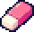 | **Remove** | Click an item in the tank to remove it. |
| 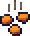 | **Drop food** | Click anywhere in the tank to drop food there. |
| 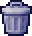 | **Clear all** | Empty the tank. |
| 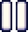 | **Hide / show** | Hide the aquarium, or bring it back. |
| 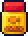 | **Feed** | Feed the whole tank at once. |
|  | **Item list + place** | Pick a fish, animal, plant, coral or decor item in the list, then click in the tank to place it. |
|  | **New scene** | Make a brand-new random aquarium. |
|  | **Settings** | Show or hide the settings below. |

### Settings

| Setting | What it does |
|---|---|
| **Theme** | Six moods: Lagoon (turquoise reef), Sunset (orange water, ancient ruins), Night (deep blue, castle on the horizon), Emerald (green water, mossy statues), Pink dream (pastel sandcastles and shells) and Red temple (crimson water, torii gate, pagoda and moon). |
| **Ground** | Sand, grey stone, volcanic or green moss. |
| **Look** | *Soft* keeps terminal text sharp (default). *Full color* shows the tank in full color. |
| **Size** | `x0.5` small, `x1` normal, `x2` big chunky pixels. |
| **Opacity** | How visible the aquarium is. |
| **Enter / Mouse / Rays** | Turn on or off: feeding when you press <kbd>Enter</kbd>, fish swimming away from the mouse, and light rays. |

Press <kbd>Esc</kbd> to leave the place, remove or drop-food tool. Your scene and settings are saved locally and restored the next time you open VS Code.

### Commands

| Command | Description |
|---|---|
| `Terminal Aquarium: Enable / Update Background` | Installs or updates the aquarium in VS Code. |
| `Terminal Aquarium: Disable Background` | Removes the aquarium and reloads the window. |

## Good to know

> [!WARNING]
> VS Code has no official API for drawing behind the terminal. To display the aquarium, this extension **patches a file inside the VS Code installation** (the Workbench HTML) and removes its Content Security Policy meta tag.

- VS Code may show an **"installation appears to be corrupt"** or **[Unsupported]** notice. That is the expected consequence of the patch.
- Removing the CSP **weakens a Workbench security protection** while the aquarium is enabled. Use the extension only if you understand and accept this.
- The extension keeps a copy of the original file before changing it. **Disable Background** puts that copy back, so VS Code returns exactly to how it was, CSP tag included.
- A VS Code update overwrites the patch. The extension notices at the next start, puts the aquarium back by itself and offers to reload the window.

## FAQ

**Is my terminal still usable?**
Yes. In **Mode normal**, the aquarium does not capture clicks or typing. The fish can still react to the mouse, and <kbd>Enter</kbd> feeds them by default; both behaviors can be toggled in the settings.

**The text is hard to read on my theme.**
Lower the opacity with the slider. The default render mode is designed for dark themes; on a light theme, try the full-color mode with a low opacity.

**The aquarium disappeared after an update.**
Restart VS Code: the extension puts it back by itself and offers to reload the window. If nothing happens, run **Terminal Aquarium: Enable / Update Background**.

**Can I pause it?**
Yes, the ⏸ button hides the aquarium and stops drawing it.

## For contributors

The whole renderer lives in [`aquarium-inject.js`](aquarium-inject.js). Sprites are embedded in that file as a single atlas (the `ATLAS` block).

```bash
# Rebuild the sprite atlas from the sheets in art/ (needs Python, Pillow and NumPy)
python tools/build_atlas.py

# Rebuild the gallery images used in this README
python tools/build_gallery.py
```

To add a sprite sheet, drop it in `art/`, list its sprite names and target sizes in `tools/build_atlas.py`, then register the new entries in the catalogue at the top of `aquarium-inject.js`.

## License

[MIT](LICENSE)
