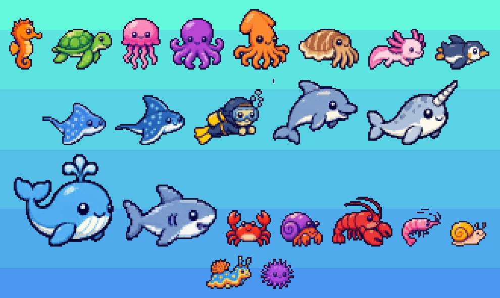
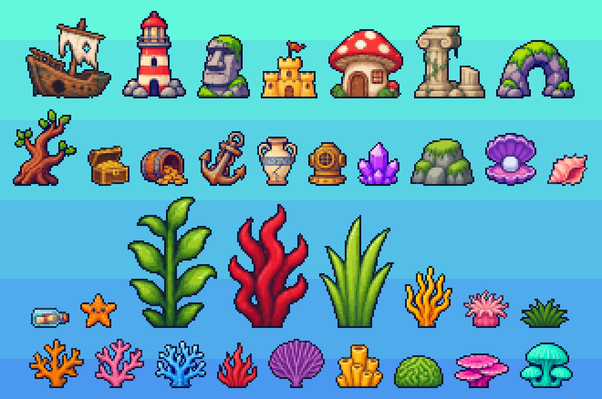

<div align="center">


# Terminal Pixel Aquarium

**A living pixel-art aquarium behind your VS Code terminal.**

Fish swim behind your commands, eat when you press <kbd>Enter</kbd>, and dart away from your mouse.

[](https://github.com/EnzoSCH1/vscode-terminal-aquarium)
[](https://code.visualstudio.com/)
[](LICENSE)
[](https://marketplace.visualstudio.com/items?itemName=EnzoSCH1.vscode-terminal-aquarium)

**English** · [Français](README.fr.md)


</div>

---

## Why you'll like it

| | |
|---|---|
| 🐠 **32 fish species** | Clownfish, blue tang, betta, goldfish, koi, lionfish, anglerfish, sunfish… each with an animated tail. Neon tetras and sardines swim in schools, clownfish stay close to their anemone. |
| 🐙 **22 other animals** | Seahorse, turtle, jellyfish, octopus, axolotl, penguin, dolphin, narwhal, baby whale, a scuba diver blowing bubbles, crabs, lobster, sea slug… and a baby shark that scares everyone else. |
| 🪸 **35 decorations** | Swaying kelp and seaweed, 10 corals, shipwreck, lighthouse, moai statue, sandcastle, mushroom house, ruins, treasure chest, anchor, amphora, crystals… |
| 🍤 **It reacts to you** | Press <kbd>Enter</kbd> in the terminal and food drops in. Fish race for it, bottom-dwellers pick up what reaches the sand, and everyone scatters when your cursor gets close. |
| 🎲 **Never the same tank** | Every new scene draws a different mix of landmarks, corals, fish and animals. Or build your own, one click at a time. |
| ⌨️ **Stays out of your way** | The aquarium is a see-through layer: your terminal text stays crisp and fully usable. Hide it in one click. |

## Screenshots

**Behind your terminal** — the default look. Text stays readable.


**Full colors** — switch the render mode when you want the tank to pop.


**Compact menu** — everything is behind the small 🐠 button in the corner.


## Meet the residents

<details open>
<summary><b>Fish</b> (32)</summary>


</details>

<details>
<summary><b>Animals</b> (22)</summary>



</details>

<details>
<summary><b>Plants, corals and decorations</b> (35)</summary>



</details>

## Installation

1. Install **Terminal Pixel Aquarium** from the [VS Code Marketplace](https://marketplace.visualstudio.com/items?itemName=EnzoSCH1.vscode-terminal-aquarium), or from a `.vsix` file with **Extensions: Install from VSIX…**
2. Accept the prompt to enable the aquarium, or open the Command Palette (<kbd>Ctrl</kbd>+<kbd>Shift</kbd>+<kbd>P</kbd> / <kbd>Cmd</kbd>+<kbd>Shift</kbd>+<kbd>P</kbd>) and run **Terminal Aquarium: Enable / Update Background**.
3. Reload the window when asked. If VS Code is installed system-wide, you may need to start it as administrator for this step.

Run the same command again after each extension update, and after each VS Code update (updates restore the original files).

## Usage

Open the bottom panel and click the **🐠** button in its bottom-right corner.

| Control | What it does |
|---|---|
| ⌨️ | Normal mode. Clicks go to the terminal as usual. |
| ➕ + list | Pick a fish, animal, plant, coral or decoration in the list, then click in the tank to place it. |
| 🧽 | Click an element to remove it. |
| 🍤 | Click anywhere to drop food there. |
| Substrate | Sand, grey stone, volcanic or green moss. |
| Render | *Lumineux* keeps terminal text sharp (default). *Couleurs pleines* shows the tank in full color. |
| Size | `x0.5` small, `x1` normal, `x2` big chunky pixels. |
| Slider | Opacity of the aquarium. |
| Entrée / Souris / Rayons | Toggle feeding on <kbd>Enter</kbd>, fleeing from the mouse, and sun rays. |
| 🍤 Nourrir | Feed the whole tank. |
| 🎲 Nouveau décor | Generate a brand-new random aquarium. |
| 🧹 / ⏸ | Empty the tank / hide or show the aquarium. |

Press <kbd>Esc</kbd> to leave the place, remove or feed tool. Your scene and settings are saved locally and restored the next time you open VS Code.

### Commands

| Command | Description |
|---|---|
| `Terminal Aquarium: Enable / Update Background` | Installs or updates the aquarium in VS Code. |
| `Terminal Aquarium: Disable Background` | Removes the aquarium and reloads the window. |

## Good to know

> [!WARNING]
> VS Code has no official API for drawing behind the terminal. To display the aquarium, this extension **patches a file inside the VS Code installation** (the Workbench HTML) and removes its Content Security Policy meta tag.

- VS Code may show an **"installation appears to be corrupt"** or **[Unsupported]** notice. That is the expected consequence of the patch.
- Removing the CSP **weakens a Workbench security protection** while the aquarium is enabled. Use the extension only if you understand and accept this.
- **Disable Background** removes the aquarium script but does not put the CSP tag back. To restore VS Code exactly as shipped, disable the aquarium and then update or reinstall VS Code.
- A VS Code update overwrites the patch. Just run the enable command again.

## FAQ

**Is my terminal still usable?**
Yes. In normal mode the aquarium ignores the mouse and keyboard entirely.

**The text is hard to read on my theme.**
Lower the opacity with the slider. The default render mode is designed for dark themes; on a light theme, try the full-color mode with a low opacity.

**The aquarium disappeared after an update.**
Run **Terminal Aquarium: Enable / Update Background** again.

**Can I pause it?**
Yes, the ⏸ button hides the aquarium and stops drawing it.

## For contributors

The whole renderer lives in [`aquarium-inject.js`](aquarium-inject.js). Sprites are embedded in that file as a single atlas (the `ATLAS` block).

```bash
# Rebuild the sprite atlas from the sheets in art/ (needs Python, Pillow and NumPy)
python tools/build_atlas.py

# Rebuild the gallery images used in this README
python tools/build_gallery.py
```

To add a sprite sheet, drop it in `art/`, list its sprite names and target sizes in `tools/build_atlas.py`, then register the new entries in the catalogue at the top of `aquarium-inject.js`.

## License

[MIT](LICENSE)
